# October 10: Starting with the matrix

I started by asking how to read all 81 keys without giving every switch its own controller pin. A six-row, fifteen-column matrix gave me enough positions, and it made the Pico 2 W feel like a workable center for the design. I also wanted a rotary encoder for volume, but I did not want that small feature to make the keyboard wider. I felt excited seeing the electronics and layout start to connect, though I knew these early choices would be hard to undo later.

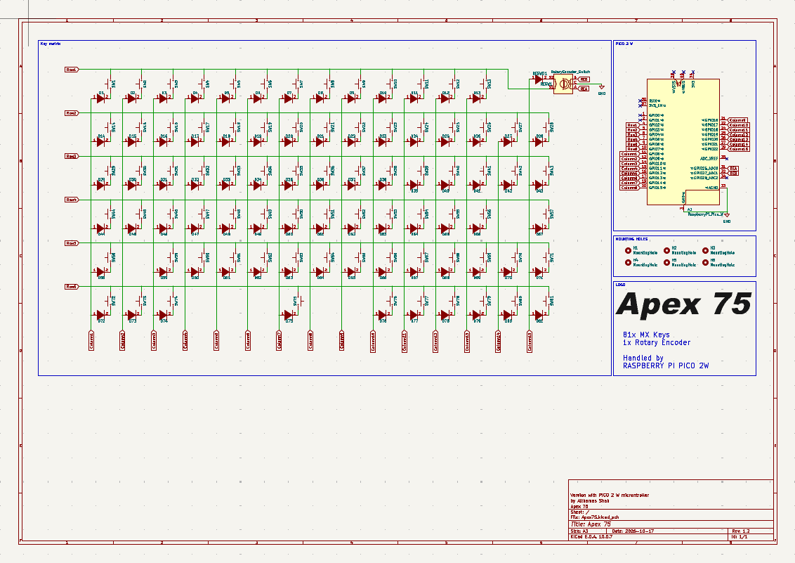

**Total time spent: 3.5 hours**

# October 10: Making the layout feel right

I placed the switches and reserved room for the Pico. A grid made the first pass straightforward, but the wider keys and navigation cluster quickly made it clear that a keyboard is not just a tidy rectangle of evenly spaced parts. I kept shifting things and checking the overall balance. That back-and-forth was a little tedious, but it was satisfying when the layout began to look intentional rather than merely fit on the board. I kept the mounting points and future case in mind as I worked.

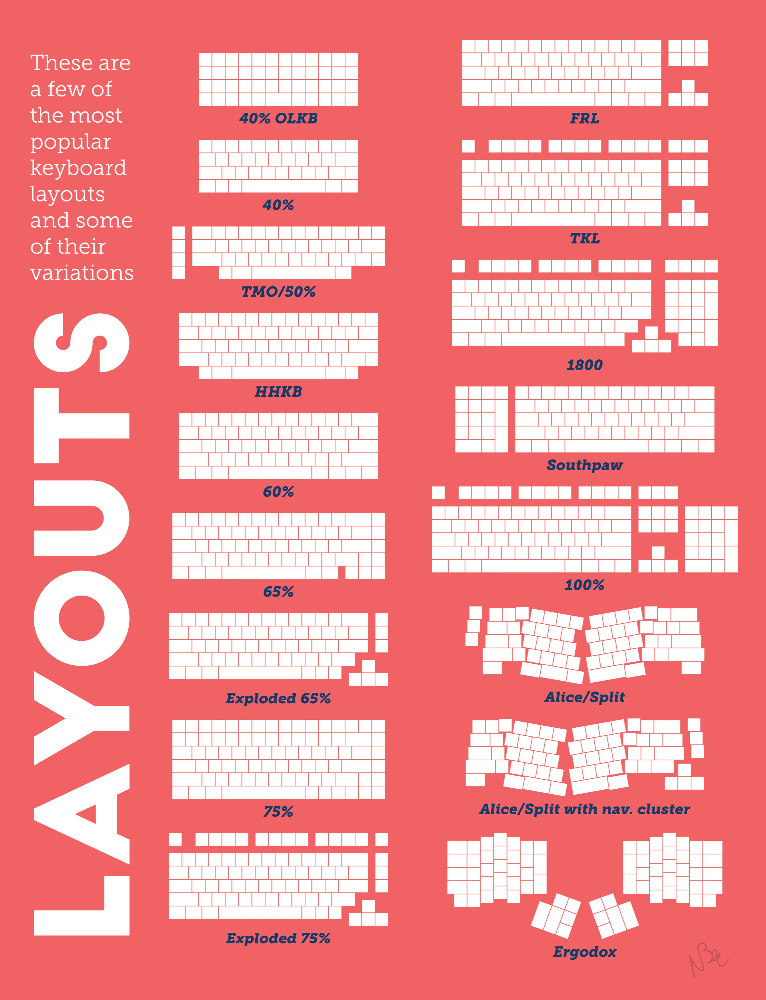

**Total time spent: 3.5 hours**

# October 11: Routing the keys

I worked through the row and column connections and routed the switch matrix across the two copper layers. The diodes are small, but their direction matters: they let the matrix tell simultaneous key presses apart. I found myself slowing down to check the orientation instead of treating each one as a routine footprint. Routing around the mounting points and keeping clearance near the Pico took patience. There is a quiet satisfaction in making connections disappear into a clean layout, even when the work itself is mostly careful checking.

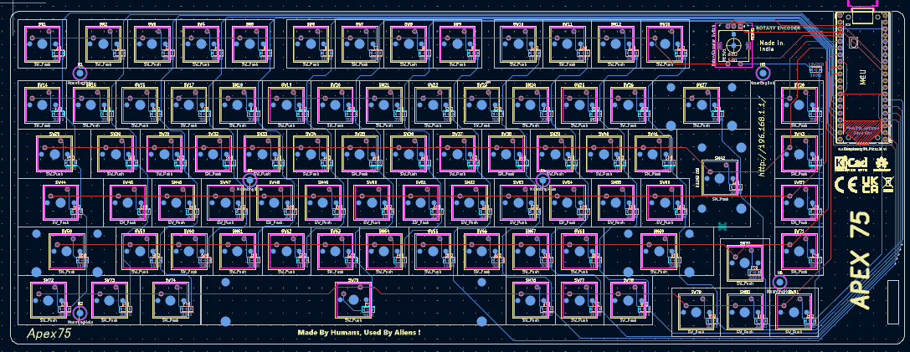

**Total time spent: 3.5 hours**

# October 12: Looking beyond the 3D view

After the main routes, I went back over the areas that are easy to miss in an attractive overview: footprint clearances, copper around mounting points, and places where the ground fill might be interrupted. It is tempting to feel finished when the 3D view looks tidy. I had to remind myself that looking good is not the same as passing a design-rule check. That made this review less glamorous, but more reassuring: I was checking the board I had actually designed, not just the picture of it. A final KiCad check is still needed before fabrication.

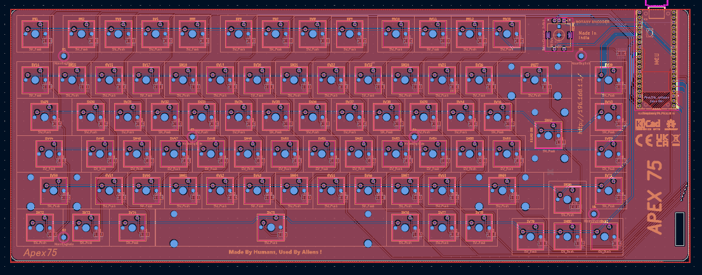
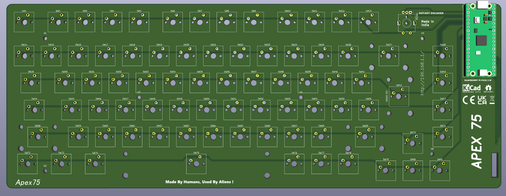
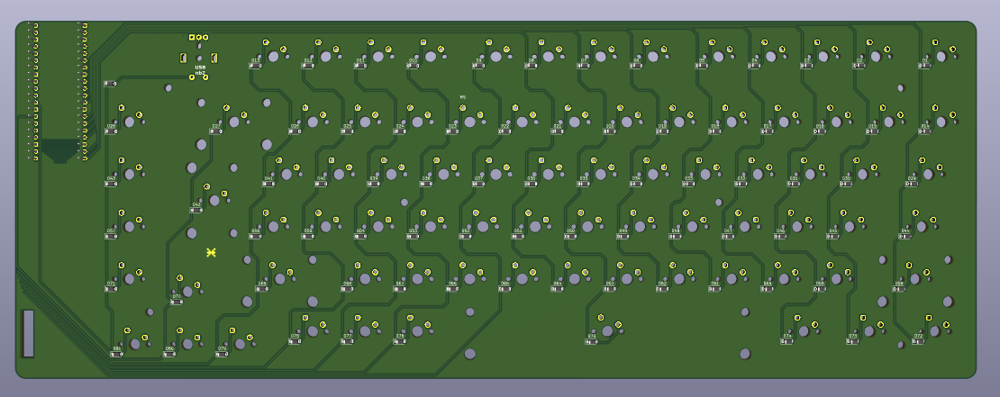

**Total time spent: 3 hours**

# October 13: Designing the switch plate

I modelled the plate separately so I could concentrate on the switch openings, outside edge, and wider keys without the case getting in the way. I enjoyed this part because the design started to feel tangible: these openings are where a hand would meet the finished keyboard. At the same time, the larger keys made me cautious. If a stabilizer opening is off, a polished-looking model will not make the real assembly any less frustrating. Keeping the plate separate gives me room to revise it if the fit needs work.

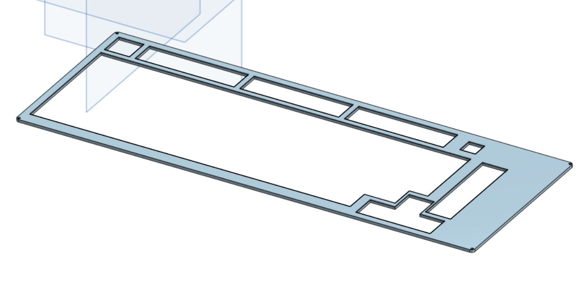
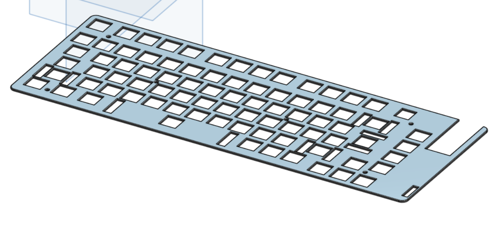

**Total time spent: 3.3 hours**

# October 14: Shaping the lower case

The lower shell had to support the PCB stack and give the case somewhere to fasten, while staying low enough not to make the keyboard feel bulky. I worked around the board footprint to place the supports and mounting features, then softened the outside edges. This was the point where the project began to feel like an object I might actually want on my desk, not just an electronics exercise. That was exciting, but it also made the unknowns more obvious: the model still needs to be checked against real parts.

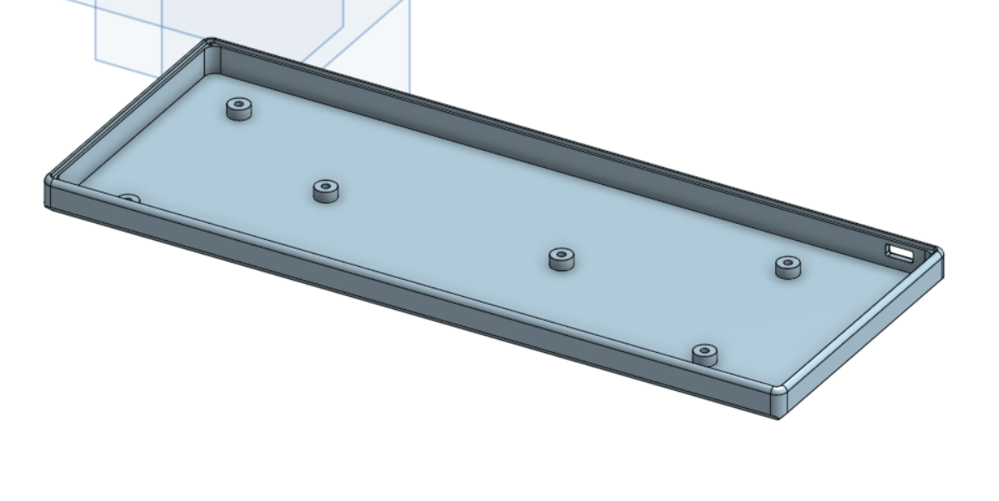

**Total time spent: 4 hours**

# October 15: Bringing the enclosure together

I worked on the top cover and checked how its openings lined up with the switches. Keeping the plate, cover, lower case, and PCB as separate models makes each piece easier to change, but it also means I have to keep checking them against one another. I felt both pleased and a little wary seeing them together: the overall shape was coming into focus, while every join introduced another place the fit could be wrong. The assembly view is useful, but it cannot promise a perfect manufactured fit.

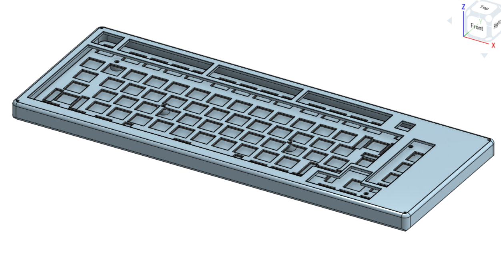

**Total time spent: 3.7 hours**

# October 16: Checking the side profile

I looked at the keyboard from the side and paid attention to the plate, switches, PCB, and case as one stack. The side profile answered questions that were easy to miss from above, especially how the overall height and internal clearances relate. It was satisfying to see the layers make sense together, but also humbling: the STEP files are separate models, and a clean view on screen is still a long way from a physical fit test. I noted that as a real next step rather than pretending the CAD view could answer everything.

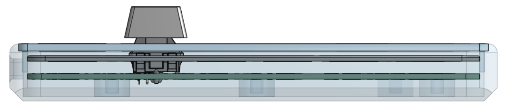

**Total time spent: 2.4 hours**

# October 17: Checking the parts list

I reviewed the parts list against the design, including the Pico 2 W, diodes, switches, stabilizers, keycaps, and case hardware. Seeing the parts gathered in one place made the project feel more concrete, and I felt some relief that the electrical plan could be translated into actual components. I also noticed how easy it is for a spreadsheet to look more certain than it is. The Pico footprint and exact diode count deserve another check before I treat the list as ready to order.

**Total time spent: 1.3 hours**

# October 17: Closing with a realistic next-step list

I brought the fabrication estimate and purchasing information together in the BOM, then reviewed the project notes so the remaining work would be visible. Finishing a set of files gives a nice sense of closure, but I do not want that feeling to turn into an exaggerated claim that the keyboard is ready to use. The firmware is an AI-generated starting point, and both the electrical behavior and mechanical fit still need real hardware checks. I finished with a clearer sense of what is complete and what I would tackle next, which feels more useful than calling the project finished too early.

**Total time spent: 1.5 hours**

**Total time spent: 29.7 hours**
