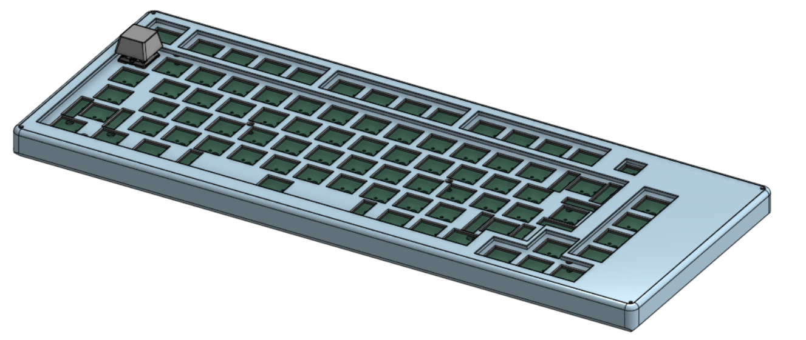

# Apex 75

A from-scratch 75% mechanical keyboard design using a Raspberry Pi Pico 2 W and a rotary encoder. The design combines an 81-key switch matrix, a two-layer PCB, and separate case, plate, and top-cover models. It is intended to be assembled as a compact daily-use keyboard; this repository currently documents the design and an untested starter firmware, not a completed physical build.

## What it does

The Pico scans six matrix rows and fifteen columns. Per-key diodes let the matrix distinguish simultaneous key presses. A rotary encoder is wired to the controller for volume adjustment in the included firmware. The encoder push contact is not connected in the current PCB netlist.

Onshape: [Link](https://cad.onshape.com/documents/abd68d6a7ddc5bb6af8bfe1f/w/8e3c131b9d3ae27d84673dad/e/142e7255003d20efc58c45f6?renderMode=0&uiState=6ad2af6546558b0aba0dbe37)
## Design images

### Schematic

### PCB

### Mechanical parts

## Firmware and flashing

The firmware is **AI-generated** and has not been tested on a physical board. It targets CircuitPython on a Raspberry Pi Pico 2 W and uses the Adafruit HID library for USB keyboard and consumer-control reports.

1. Install a CircuitPython build for the Raspberry Pi Pico 2 W.
2. Copy `adafruit_hid` from the Adafruit CircuitPython library bundle into `CIRCUITPY/lib/`.
3. Copy `firmware/code.py` to the root of the `CIRCUITPY` drive.
4. After the board restarts, test the key positions and encoder with a keyboard tester before normal use.

The firmware maps the matrix as six rows on GP2–GP7 and fifteen columns on GP8–GP22. The encoder A/B pins use GP26 and GP27, as indicated by the production netlist. The editable keymap is in `firmware/code.py`; check it against the physical layout before flashing. The matrix scan reverses the scanner's row/column arguments so the diodes and RP2350 pull-resistor behavior match CircuitPython's documented setup.

## Bill of materials

The CSV version, including vendor links and notes, is [BOM.csv](BOM.csv). Values for products are carried over from the project's existing estimate. Shipping and tax are explicit allowances; actual checkout charges may differ.

| Quantity | Item | Vendor | Cost (INR) | Cost (USD) |
| --- | --- | --- | ---: | ---: |
| 1 | Raspberry Pi Pico 2 W | [Robu.in](https://robu.in/) | ₹635.00 | $8.00 |
| 1 | Custom 75% keyboard PCB | [PowerPCB](https://powerpcb.com/) | ₹4,692.00 | $52.00 |
| 84 | MX mechanical switches (Akko V5) | [StacksKB](https://stackskb.com/store/akko-v5-creamy-yellow-pro-switch-pack-of-45/) | ₹2,398.00 | $27.00 |
| 4 + 1 (6.25U) | Clear screw-in stabilizer set | [StacksKB](https://stackskb.com/store/durock-clear-screw-in-stabilizers-v2/?attribute_combination=4%2B1+Set&attribute_spacebar-size=6.25U) | ₹1,595.00 | $18.00 |
| 84 | 1N4148W SOD-123 diodes | [Robu.in](https://robu.in/) | ₹122.00 | $1.50 |
| 1 | Rotary encoder with push button | [Robu.in](https://robu.in/product/hongyan-ec11h-7ce15p1zd15f7-rotary-encoder-with-push-button-switch-vertical-plug-in-5-pin-360-degree/) | ₹55.00 | $1.00 |
| 1 set | 75%-compatible keycaps | [Robu.in](https://robu.in/) | ₹2,399.00 | $27.00 |
| 7 | M2.5 screws | [OnlyScrews.in](https://onlyscrews.in/) | ₹43.30 | $0.50 |
| 7 | M2.5 heat-set inserts | [OnlyScrews.in](https://onlyscrews.in/) | ₹14.00 | $0.20 |
| 5 | M1.6 screws | [OnlyScrews.in](https://onlyscrews.in/) | ₹16.00 | $0.20 |
| 1 allowance | Shipping | — | ₹189.92 | $2.00 |
| 1 allowance | Tax | — | ₹284.88 | $3.00 |
|  | **Estimated total including shipping and tax** |  | **₹12,444.10** | **$140.40** |

